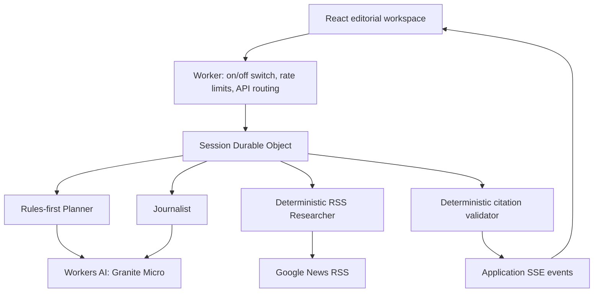

# AI News Desk architecture

## Scope

The application uses React 19 and TypeScript. One Cloudflare Worker serves static assets and a same-origin API. Workers AI supplies inference; it does not search the web. The app is public, uses key-free Google/Bing News RSS with approved publisher-feed fallback, and has isolated temporary browser-session conversations rather than a saved-chat library. No sign-in or group membership is required. The operator can close it from the Cloudflare dashboard.

## Boundaries

- `src/`: presentation, settings, selected source, stream consumption. No inference credentials or trusted evidence creation.
- `shared/`: serializable conversation and event contracts, without secrets.
- `worker/`: availability control, rate limits, bounded research, inference, validation, and session ownership.
- Durable Objects are addressed by an anonymous namespace plus an unguessable browser-session cookie, not by a shared conversation or IP. Never put conversation state in Worker globals.
- Only the server creates evidence inventories. The client sends a question and settings, not trusted sources or system messages.
- Research is restricted to fixed Google News and Bing News HTTPS RSS search paths and an explicit publisher-feed allowlist. Publisher article URLs are validated for display but are not fetched. Bing's encoded publisher links are decoded as data without following redirects. No arbitrary URL proxy exists.

## Session lifecycle

SQLite-backed Durable Object storage survives eviction. A session holds a bounded conversation, active evidence, failed question, and idempotent turn IDs. A new-topic search clears active evidence before fetching; previous completed answers retain their snapshots. One generation runs per session. Retry reuses the failed question without adding a duplicate user message.

Application data expires after two hours of inactivity, checked on access and cleaned with an alarm. Clear deletes application storage and cancels an active turn. This is application retention, not a promise of instant deletion from provider recovery systems or logs. There is no cross-user chat cache or saved-chat index.

## Protocol

- `GET /api/session`: initialize/read this browser session without requiring sign-in.
- `POST /api/turn`: bounded question, locale, source count, client-generated turn ID; SSE response.
- `POST /api/cancel`: abort the active turn.
- `DELETE /api/session`: clear the conversation.
- Unknown `/api/*` routes return JSON 404, not the SPA document.

SSE events are `status`, `sources`, `draft_delta`, `completed`, and `failed`. Drafts are plain text and provisional. Only validated `completed` answers are saved. A disconnected client or canceled turn must not save a partial draft. Stream parsing must tolerate arbitrary chunk boundaries and detect missing terminal events.

## Public operation and shutdown

The app is open to everyone while enabled. Turn requests are rate-limited using Cloudflare's connection IP, in addition to session-level limits. Changing cookies does not reset the connection limit. IPs can represent shared networks and Cloudflare's rate counters are local/eventually consistent; this is basic abuse protection, not an exact global spend cap.

All routes pass through the Worker, including static assets. Setting `APP_ENABLED=false` in the Cloudflare dashboard returns a closed page or JSON 503 before session access, research, or inference. The flag defaults to open when absent and is deliberately not declared in local Wrangler vars; `keep_vars=true` preserves the operator's dashboard setting on later deployments. Previously submitted requests/inference can still finish.

## Non-goals

No autonomous tool loop, D1, R2, Vectorize, or background news crawler. Full-article extraction, user accounts, and custom user-supplied feeds are not capabilities of the initial release.
